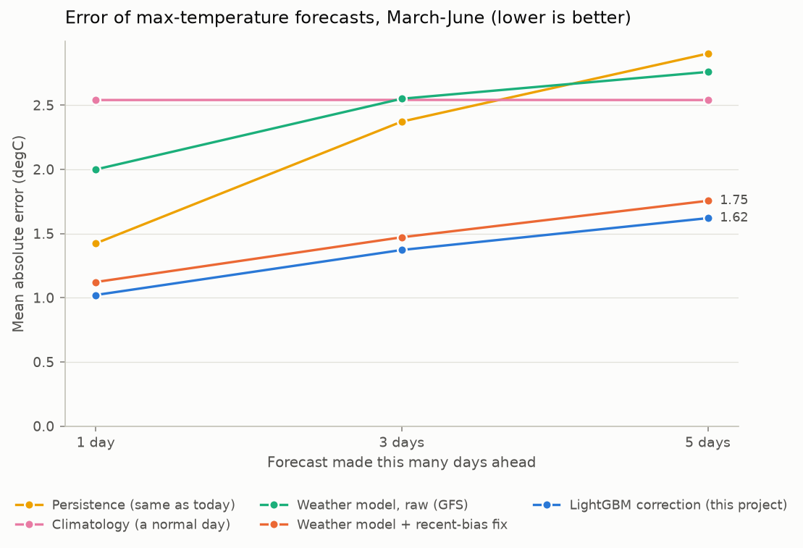
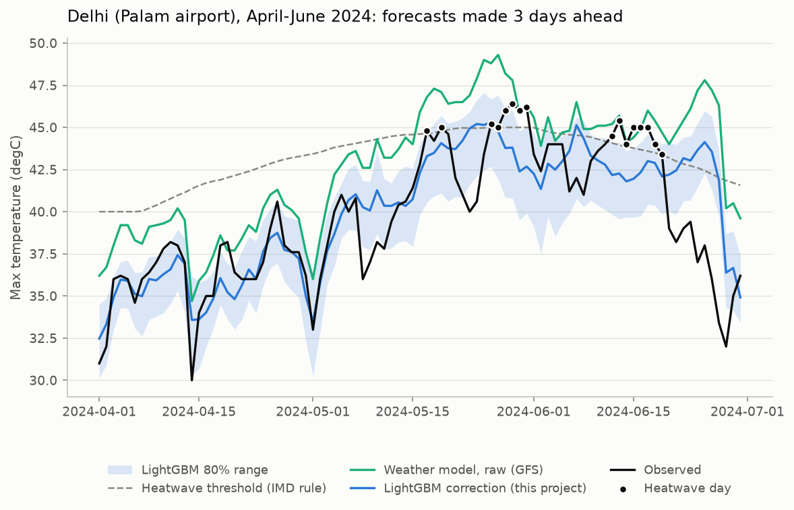
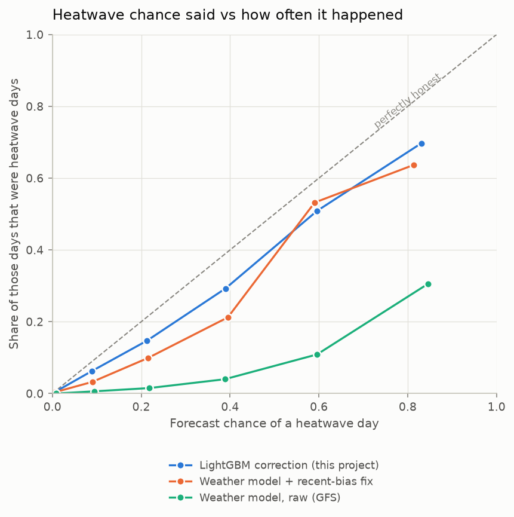
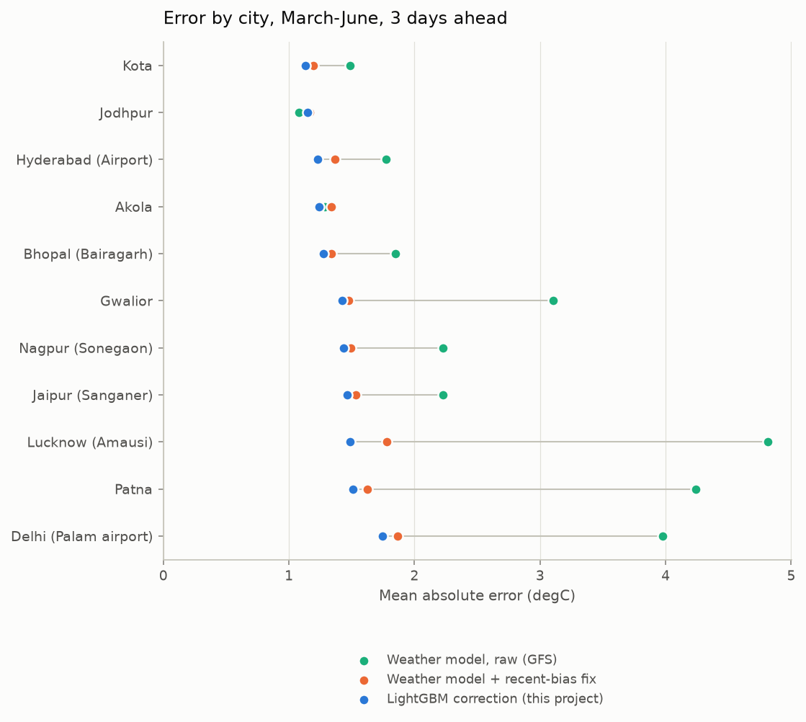

# Heatwave early warning for Indian cities

**Can machine learning make a free global weather model better at warning of heatwaves in Indian
cities, 1 to 5 days ahead?** This project tests that honestly: every forecast is made as if it were
that day, with only the data that existed then, and compared against the simple methods a
forecaster would actually use.

- **Data:** 11 IMD airport weather stations (Delhi, Jaipur, Jodhpur, Lucknow, Patna, Gwalior, Kota,
  Bhopal, Nagpur, Akola, Hyderabad), hourly readings 1991-2026, plus what the GFS weather model
  forecast for each station 1-6 days earlier (archived forecasts, 2021-2026). Free sources, no key.
- **Target:** the day's maximum temperature, and whether the day is a heatwave by the IMD rule.
- **Model:** LightGBM learns the weather model's *error* at each station (quantile regression,
  so every forecast comes with an 80% range), retrained every month in a walk-forward backtest.
- **App:** a Streamlit dashboard with a daily warning bulletin and a city explorer.

## Results

<!-- RESULTS:START -->
Test period: forecasts made 2023-01-01 .. 2026-02-10 for 11 cities (36,235 scored forecasts; 11,998 of them for March-June, with 149 heatwave days per lead).

**Error of the max-temperature forecast, March-June** (mean absolute error, degC; lower is better):

| Days ahead | Persistence (same as today) | Climatology (a normal day) | Weather model, raw (GFS) | Weather model + recent-bias fix | LightGBM correction (this project) |
|---|---|---|---|---|---|
| 1 | 1.42 | 2.54 | 2.00 | 1.12 | 1.02 |
| 3 | 2.37 | 2.54 | 2.55 | 1.47 | 1.37 |
| 5 | 2.90 | 2.54 | 2.76 | 1.75 | 1.62 |

**Is LightGBM really better than the best simple method?** At 3 days ahead, March-June: 1.37 vs 1.47 degC for *Weather model + recent-bias fix*, 0.10 degC better (7%), 95% interval 0.03 to 0.17 degC (block bootstrap over weeks).

| Days ahead | best_baseline | mae_best_baseline | mae_lgbm | improvement | ci_low | ci_high |
|---|---|---|---|---|---|---|
| 1 | Weather model + recent-bias fix | 1.12 | 1.02 | 0.10 | 0.07 | 0.14 |
| 3 | Weather model + recent-bias fix | 1.47 | 1.37 | 0.10 | 0.03 | 0.17 |
| 5 | Weather model + recent-bias fix | 1.76 | 1.62 | 0.14 | 0.02 | 0.25 |

**Why a bias fix helps so much:** in March-June the raw weather model's 3-day forecast was 4.6 degC too warm on average at Lucknow (Amausi), but 0.2 degC too warm at Jodhpur: each station has its own error, so the model must be corrected station by station.

**Heatwave chance** (Brier score, lower is better; skill vs climatology, higher is better), 3 days ahead: LightGBM 0.0270 (skill 0.20), bias-fixed weather model 0.0281 (skill 0.17), raw weather model 0.0874 (skill -1.59). Gain over the best other method: 0.0011, 95% interval -0.0017 to 0.0036 (the interval includes 0: not a clear win). Tried and dropped: a direct LightGBM yes/no classifier scored 0.0313 (worse; too few heatwave days to learn from).

**Heatwave warnings, 3 days ahead** (POD = heatwave days warned; FAR = warnings that were false alarms):

| method | warnings | hits | misses | false_alarms | POD | FAR | CSI |
|---|---|---|---|---|---|---|---|
| Weather model, raw (GFS) | 598 | 130 | 19 | 468 | 0.87 | 0.78 | 0.21 |
| Weather model + recent-bias fix | 142 | 72 | 77 | 70 | 0.48 | 0.49 | 0.33 |
| LightGBM, chance >= 50% | 110 | 57 | 92 | 53 | 0.38 | 0.48 | 0.28 |
| LightGBM, chance >= 30% (cautious) | 218 | 88 | 61 | 130 | 0.59 | 0.60 | 0.32 |

**80% range** (share of real values inside; should be 0.80): 1 day: 0.77 raw -> 0.81 calibrated, 3 days: 0.74 raw -> 0.81 calibrated, 5 days: 0.73 raw -> 0.81 calibrated.









All numbers: `results/` (one CSV per table). Written by `evaluate.py`.
<!-- RESULTS:END -->

## How it works

```
download.py   Meteostat hourly station files + Open-Meteo archived GFS forecasts  -> data/raw/
dataset.py    clean, daily max (10:00-18:00 IST), climate normal, IMD threshold   -> data/processed/daily.csv
features.py   one row per (city, day t, lead 1/3/5 days): only what was known on day t
backtest.py   monthly walk-forward retraining, quantile LightGBM, conformal range  -> results/predictions.csv
evaluate.py   scores vs 4 baselines, bootstrap intervals, charts, this README     -> results/, images/
app.py        Streamlit dashboard on top of results/
```

**The heatwave rule (IMD, plains).** A day is a heatwave day at a station if the max temperature is
at least 40 degC *and* at least 4.5 degC above that day's normal, or if it is 45 degC or more. That is
one number per day: `threshold = min(45, max(40, normal + 4.5))`. The normal is the 1991-2020 average
for that calendar day, smoothed over a month.

**The forecast.** On the evening of day t (that day's max is known by then) a forecast is made for
day t + 1, t + 3 and t + 5. LightGBM predicts *observed max - weather model forecast* from:
the weather model's forecast and how it changed since the previous run, today's observed max/min and
3-day mean, today's anomaly, the model's error over the last 7 and 14 days, the normal and the
heatwave threshold of the target day, season, and city. Three models per lead give the 10th, 50th
and 90th percentile. The heatwave chance is the chance that the max reaches the threshold, from the
median and the (calibrated) range.

**The four baselines it must beat:**

| Baseline | Forecast for day t + L |
|---|---|
| Persistence | same as today's max |
| Climatology | the normal for that day |
| Weather model, raw | the GFS forecast for the station |
| Weather model + recent-bias fix | GFS minus its average error of the last 14 days (what forecasters do by hand) |

The last one is strong. Beating it is the real test.

### Keeping the backtest honest

- **No future data.** Row t uses station readings up to day t and forecasts issued on or before day t.
  A test changes every later value and checks that row t does not change (`tests/test_features.py`).
- **Retraining only on observed answers.** On retrain day R the models see only rows whose *target*
  day is on or before R (a 5-day-ahead forecast made on R - 2 is not yet known on R).
- **Same days for every method.** Every score uses only the rows where all methods have a forecast.
- **Fixed normals.** The climate normal comes from 1991-2020, before any test year.
- **Calibrated ranges that also only look back.** The 80% range is widened or narrowed by what the
  last 365 days of *already observed* errors needed (online conformal calibration).
- **Uncertainty on the comparison.** Differences come with a 95% interval from a block bootstrap that
  resamples whole weeks, because errors on nearby days and nearby cities are linked.

## What I found along the way

- **A one-day shift in a ready-made data file.** Meteostat's daily summary file had some months where
  the station's daily max was moved by one day (seen at Jaipur, Hyderabad and Delhi): the daily
  changes of the observations lined up with the model's changes one day *earlier*. The project
  therefore builds the daily max itself from the hourly readings (in Indian time), and the shift is gone.
- **The raw weather model has a strong station-specific bias** (see Results). A per-station
  correction is most of the gain; LightGBM adds a smaller but statistically clear improvement on top.
- **Tried and dropped: a direct heatwave classifier.** A LightGBM yes/no model for "heatwave day"
  scored worse than the chance computed from the temperature forecast: there are only about 150
  heatwave days per lead in three test summers, too few to learn a yes/no boundary well. It is still
  computed (`p_classifier` in `results/predictions.csv`) so the comparison can be checked.
- **Heatwave chance: better, but not clearly.** LightGBM's heatwave chances are the most reliable
  (closest to the diagonal in the reliability chart), but the gain over the bias-fixed weather model
  is inside the noise for three test summers.

## Limitations

- **Only 3 test summers** (2023-2025) and about 150 heatwave days per lead: the heatwave-chance scores are
  noisy. Temperature errors (about 12,000 March-June forecasts) are much more certain.
- **One weather model.** The free archive has GFS from April 2021; better models (ECMWF, IMD's own)
  would start from a smaller error.
- **"Max temperature" here is the highest hourly reading between 10:00 and 18:00**, a little below
  the official max-thermometer value. The same definition is used for the weather model, so the
  comparison is fair, but heatwave counts are slightly lower than IMD's.
- **Single-station heatwave days.** IMD declares a heatwave for a region (two or more stations, two
  days); this project scores station-days.
- **Station data quality.** 4 of the 15 candidate stations were dropped for having fewer than 10
  years in 1991-2020 (`results/cities.csv`); the remaining ones still have gaps.
- **Not an operational system.** It shows what a correction layer could add; it is not a substitute
  for IMD warnings.

## How to run

Needs Python 3.11+ (built on 3.14). Everything is free; no API key.

```bash
python -m venv .venv
.venv\Scripts\activate            # Windows  (macOS/Linux: source .venv/bin/activate)
pip install -r requirements.txt

python run_all.py                 # download (~2 min) -> dataset -> backtest (~1.5 min) -> evaluate
streamlit run app.py              # the dashboard
python -m pytest                  # the tests
```

`python run_all.py --skip-download` reuses the files in `data/raw/`. Each step can also be run on its
own (`python download.py`, `python dataset.py`, `python evaluate.py`). All settings are in `config.py`.

## Project layout

| File | What it does |
|---|---|
| `config.py` | every setting: cities, leads, IMD rule, backtest, model parameters |
| `download.py` | downloads the raw data, writes SHA-256 fingerprints to `data/raw/manifest.json` |
| `dataset.py` | cleaning rules (counted in `results/data_quality.csv`), daily table, normals, threshold |
| `features.py` | features and baselines, one row per city, day and lead |
| `backtest.py` | walk-forward training, quantile models, conformal calibration, heatwave chance |
| `metrics.py` | MAE, block bootstrap, Brier score, warning scores, reliability, coverage |
| `charts.py`, `evaluate.py` | charts and the results section of this README |
| `app.py` | Streamlit dashboard |
| `run_all.py` | the whole pipeline in one command |
| `tests/` | pytest: IMD rule, cleaning, no-leakage, training cut-off, metrics, download, app |

## Data and credits

- Station observations: [Meteostat](https://meteostat.net) bulk data (from NOAA / national weather
  services), [CC BY-NC 4.0](https://dev.meteostat.net/terms.html).
- Archived weather-model forecasts: [Open-Meteo](https://open-meteo.com) Previous Runs API, NOAA GFS,
  [CC BY 4.0](https://open-meteo.com/en/license).
- Heatwave criteria: India Meteorological Department.

The raw data is not part of this repository; `run_all.py` downloads it. Code: MIT licence (`LICENSE`).
