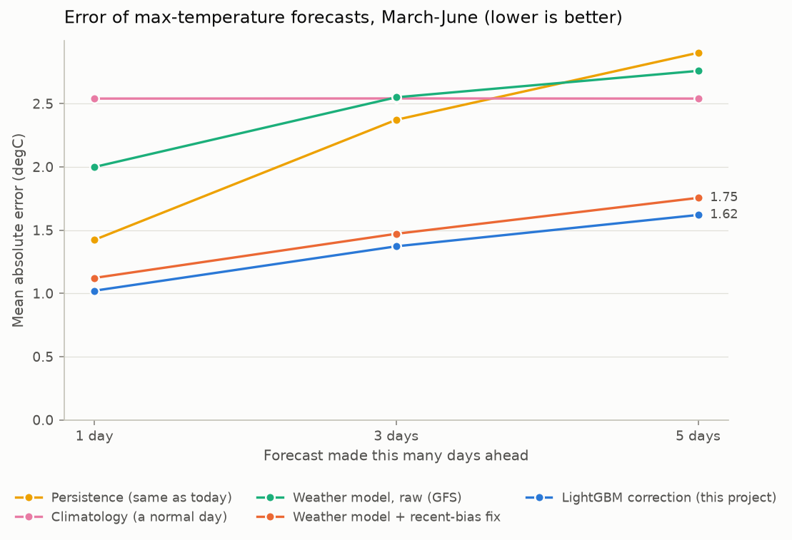
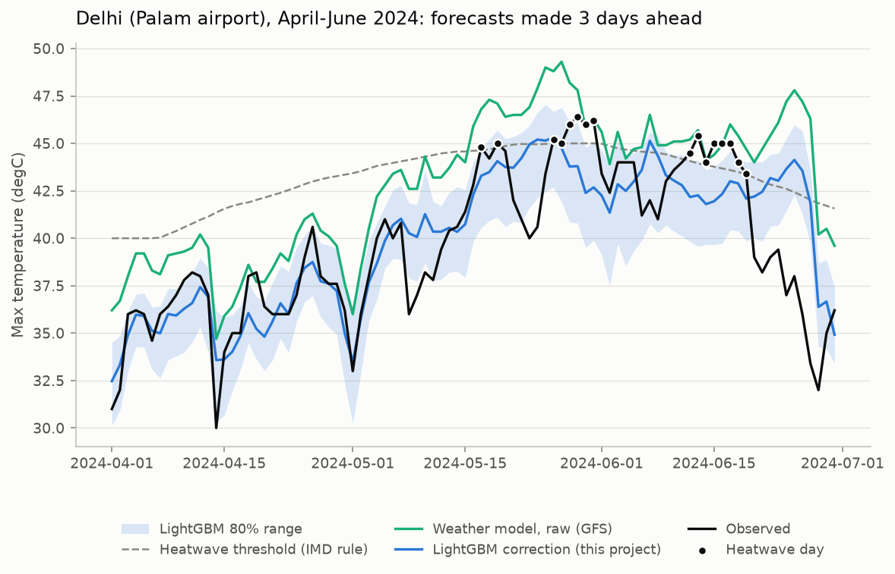
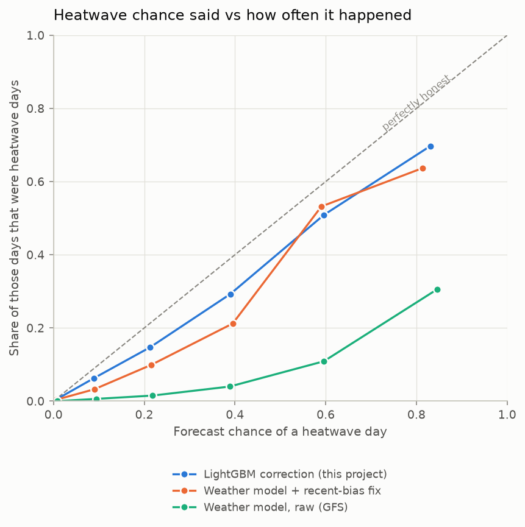
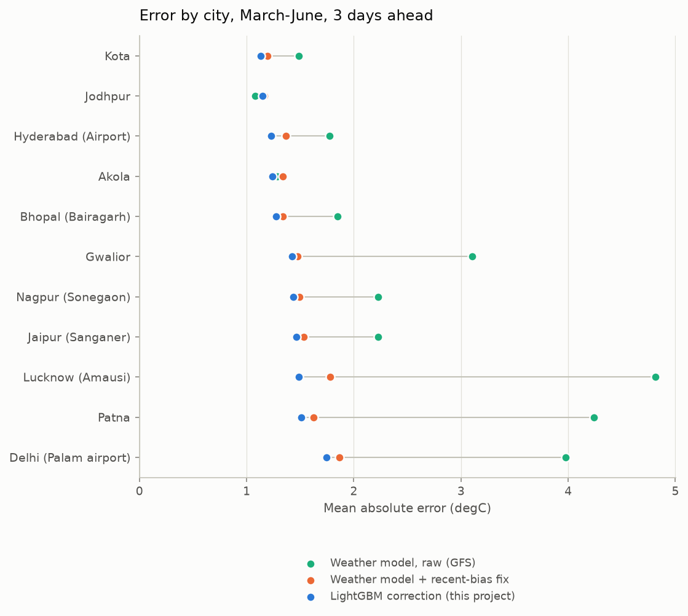

# Results

Test period: forecasts made 2023-01-01 .. 2026-02-10 for 11 cities (36,235 scored forecasts; 11,998 of them for March-June, with 149 heatwave days per lead).

**Error of the max-temperature forecast, March-June** (mean absolute error, degC; lower is better):

| Days ahead | Persistence (same as today) | Climatology (a normal day) | Weather model, raw (GFS) | Weather model + recent-bias fix | LightGBM correction (this project) |
|---|---|---|---|---|---|
| 1 | 1.42 | 2.54 | 2.00 | 1.12 | 1.02 |
| 3 | 2.37 | 2.54 | 2.55 | 1.47 | 1.37 |
| 5 | 2.90 | 2.54 | 2.76 | 1.75 | 1.62 |

**Is LightGBM really better than the best simple method?** At 3 days ahead, March-June: 1.37 vs 1.47 degC for *Weather model + recent-bias fix*, 0.10 degC better (7%), 95% interval 0.03 to 0.17 degC (block bootstrap over weeks).

| Days ahead | best_baseline | mae_best_baseline | mae_lgbm | improvement | ci_low | ci_high |
|---|---|---|---|---|---|---|
| 1 | Weather model + recent-bias fix | 1.12 | 1.02 | 0.10 | 0.07 | 0.14 |
| 3 | Weather model + recent-bias fix | 1.47 | 1.37 | 0.10 | 0.03 | 0.17 |
| 5 | Weather model + recent-bias fix | 1.76 | 1.62 | 0.14 | 0.02 | 0.25 |

**Why a bias fix helps so much:** in March-June the raw weather model's 3-day forecast was 4.6 degC too warm on average at Lucknow (Amausi), but 0.2 degC too warm at Jodhpur: each station has its own error, so the model must be corrected station by station.

**Heatwave chance** (Brier score, lower is better; skill vs climatology, higher is better), 3 days ahead: LightGBM 0.0270 (skill 0.20), bias-fixed weather model 0.0281 (skill 0.17), raw weather model 0.0874 (skill -1.59). Gain over the best other method: 0.0011, 95% interval -0.0017 to 0.0036 (the interval includes 0: not a clear win). Tried and dropped: a direct LightGBM yes/no classifier scored 0.0313 (worse; too few heatwave days to learn from).

**Heatwave warnings, 3 days ahead** (POD = heatwave days warned; FAR = warnings that were false alarms):

| method | warnings | hits | misses | false_alarms | POD | FAR | CSI |
|---|---|---|---|---|---|---|---|
| Weather model, raw (GFS) | 598 | 130 | 19 | 468 | 0.87 | 0.78 | 0.21 |
| Weather model + recent-bias fix | 142 | 72 | 77 | 70 | 0.48 | 0.49 | 0.33 |
| LightGBM, chance >= 50% | 110 | 57 | 92 | 53 | 0.38 | 0.48 | 0.28 |
| LightGBM, chance >= 30% (cautious) | 218 | 88 | 61 | 130 | 0.59 | 0.60 | 0.32 |

**80% range** (share of real values inside; should be 0.80): 1 day: 0.77 raw -> 0.81 calibrated, 3 days: 0.74 raw -> 0.81 calibrated, 5 days: 0.73 raw -> 0.81 calibrated.

All numbers: `results/` (one CSV per table). Written by `evaluate.py`.
